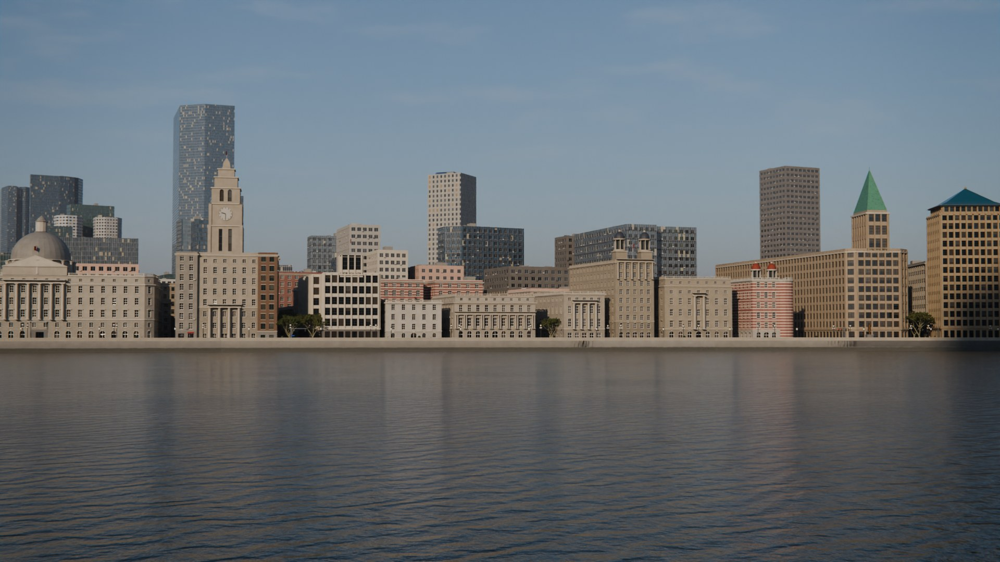
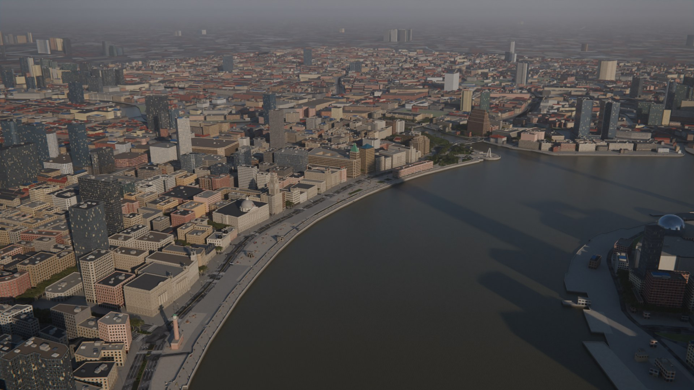
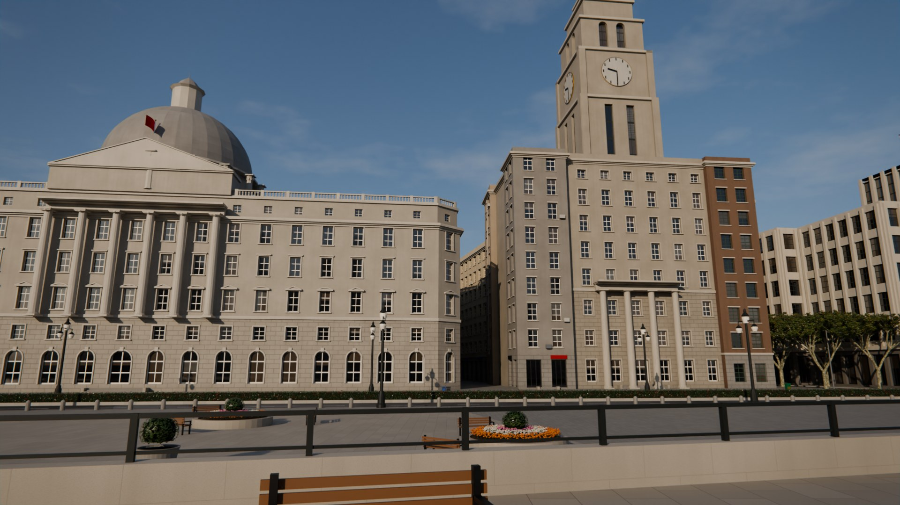
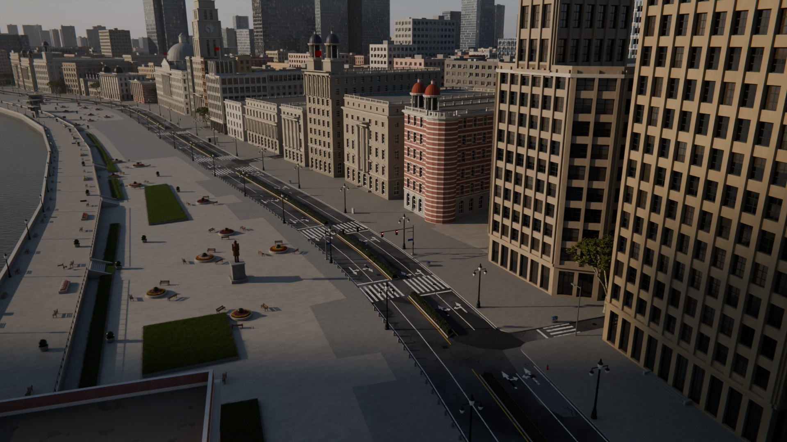
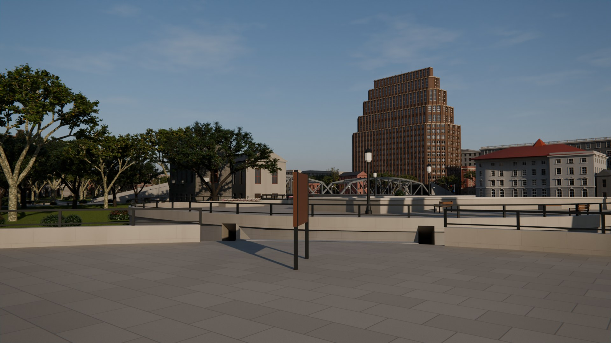
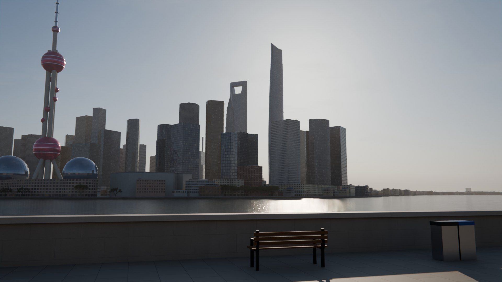
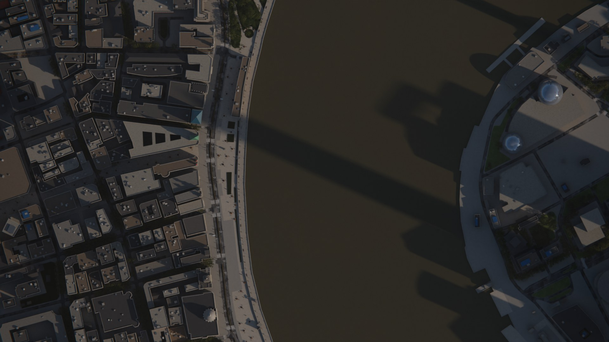

# 上海外滩 · 写实三维还原

用真实地图数据逐栋重建的上海外滩：**Blender 写实场景**（Cycles 渲染）＋ **浏览器第一人称漫游版**（可以走到金陵东路渡口，坐东金线轮渡过江去陆家嘴）。不含行人和车辆，交通网络（车道、标线、斑马线、信号灯、隔离带、桥梁、高架、隧道口、公交站、轮渡航线）全部还原。



| | |
|---|---|
|  |  |
|  |  |
|  |  |

## 范围

- **核心区（逐栋精细建模）**：南起延安东路（外滩 1 号、外滩信号台），北到苏州河北岸（外白渡桥、上海大厦、浦江饭店、俄罗斯领事馆），西到四川中路 / 虎丘路（含外滩源历史街区），东到黄浦江。约 **1.6 km × 0.6 km**。
- **对岸背景**：浦东滨江与陆家嘴（东方明珠、上海中心、环球金融中心、金茂大厦、国际会议中心两个玻璃球体）。
- **外围城市环**：周边约 7 km 范围内 **27,593 栋**真实建筑轮廓（只做体块），保证鸟瞰和远景不是"悬空的一块地"。
- **远景环**：约 36 km 见方范围内有高度数据的 **1,226 栋**真实高层（≥45 m 或 ≥15 层）和真实水系（黄浦江一直延伸到地平线），其余地面用程序化街区纹理铺到 40 km，隐没在城市霾里。

## 已知客观事实（数据来源）

| 内容 | 来源 |
|---|---|
| 建筑轮廓、层数、名称、道路中心线与等级、单行线、桥梁 / 隧道层级、红绿灯与人行横道位置、公交站、树列、公园草地、黄浦江与苏州河岸线、轮渡航线 | [Overture Maps Foundation](https://overturemaps.org) release `2026-10-21.0`，数据来自 © [OpenStreetMap](https://www.openstreetmap.org/copyright) 贡献者（ODbL） |
| 中山东一路地面车道：2010 年外滩综合改造后由 11 条减为 **4 条**，过境交通走外滩隧道 | [China Daily 2010-03-28](https://covid-19.chinadaily.com.cn/china/2010-03/28/content_9653113.htm) |
| 防汛墙顶标高 **6.9 m**、观景平台宽约 15 m | [新民周刊《外滩综合改造 越改越精彩》](https://m.xinminweekly.com.cn/content/9413.html) |
| 外白渡桥：全长 **104.9 m**、宽 **18.4 m**、两跨（最大跨 52.16 m）、骆驼式钢桁架 | [Wikipedia: Waibaidu Bridge](https://en.wikipedia.org/wiki/Waibaidu_Bridge) |
| 沙逊大厦（和平饭店北楼）：高 **77 m**，10 层（局部 13 层），约 19 m 高的墨绿色铜皮金字塔顶 | [中国新闻网 2023-04-06](https://www.chinanews.com/sh/2023/04-06/9985476.shtml) |
| 中国银行大楼：最终设计 **15 层、227 英尺（≈69.2 m）** | [中国银行行史](https://www.boc.cn/en/aboutboc/ab7/200809/t20080926_1601875.html) |
| 外滩信号台：高 **36.8 m**（信号焦点高 49.8 m），1907 年，红白相间 | [Wikipedia: Gutzlaff Signal Tower](https://en.wikipedia.org/wiki/Gutzlaff_Signal_Tower) |
| 人民英雄纪念塔：高 **24 m**，三支"枪"形塔身 | [Wikipedia](https://en.wikipedia.org/wiki/Shanghai_People%27s_Heroes_Memorial_Tower) |
| 上海大厦（百老汇大厦）：屋顶高 **78 m**，19 层 | [Wikipedia: Broadway Mansions](https://en.wikipedia.org/wiki/Broadway_Mansions) |
| 汇丰银行大楼：主体 5 层、中部 7 层，仿万神庙穹顶 | [澎湃新闻](https://www.thepaper.cn/newsDetail_forward_16367281) |
| 半岛酒店：15 层，自 10 层起退台 | [HOK 项目页](https://hok.com/projects/view/the-peninsula-shanghai) |
| 陆家嘴超高层高度与形体 | OSM building parts（东方明珠 468 m、上海中心 632 m、环球金融中心 492 m、金茂 420.5 m）；环球金融中心的朝向取自 OSM 顶部轮廓（顶部"刀片"沿约 50° 方向，所以从外滩能看到梯形开口） |
| 外滩金融牛：2010 年落成，长约 **5.2 m**、高约 **3.2 m**；位置取 OSM（汇丰银行南侧的外滩金融广场） | [Wikipedia: Bund Bull](https://en.wikipedia.org/wiki/Bund_Bull) |

逐栋资料（含每条事实的出处链接和可信度 A/B/C）见 [`data/building_facts.json`](data/building_facts.json)，地标参数见 [`data/landmarks.json`](data/landmarks.json)，对 OSM 的逐栋修正见 [`data/building_overrides.json`](data/building_overrides.json)。

### 外滩建筑一览

可信度：**A** = 权威来源直接给出；**B** = 由来源给出的层数等推算；**C** = 依据照片和比例的估计。

| 门牌 | 建筑 | 年份 | 层数 | 高度 (m) | 可信度 |
|---|---|---|---|---|---|
| 1 | 亚细亚大楼 | 1916 | 8（1939 年加建 1 层） | 35 | B |
| 2 | 上海总会（华尔道夫） | 1910 | 6 | 31 | C |
| 3 | 有利大楼 | 1916 | 6 | 30 | B |
| 5 | 日清大楼 | 1925 | 6 | 27 | B |
| 6 | 中国通商银行（1906–07 重建） | 1907 | 4 | 24 | B |
| 7 | 大北电报公司 | 1908 | 5 | 26 | B |
| 9 | 轮船招商局 | 1901 | 3 | 17 | A |
| 12 | 汇丰银行 | 1923 | 5（中部 7） | 31（穹顶更高） | B |
| 13 | 江海关 | 1927 | 8 | 钟楼 79.2* | B |
| 14 | 交通银行 | 1948 | 6（中部 8） | 30 | B |
| 15 | 华俄道胜银行 | 1902 | 3 | 21.5 | C |
| 16 | 台湾银行 | 1927 | 4 | 24 | B |
| 17 | 字林西报 | 1924 | 9＋屋顶塔楼 | 40.2 | B |
| 18 | 麦加利银行 | 1923 | 5 | 28 | B |
| 19 | 汇中饭店 | 1908 | 6 | 30 | C |
| 20 | 沙逊大厦 | 1929 | 10（局部 13） | 77 | A |
| 23 | 中国银行 | 1937 | 15 | 69.2* | A |
| 24 | 横滨正金银行 | 1924 | 7 | 32 | B |
| 26 | 扬子大楼 | 1920 | 7 | 32 | B |
| 27 | 怡和洋行 | 1922 | 7 | 32 | A |
| 28 | 格林邮船 | 1922 | 7 | 32 | B |
| 29 | 东方汇理银行 | 1914 | 3 | 21.6 | A |
| 32 | 半岛酒店 | 2009 | 15 | 62 | B |
| 33 | 原英国领事馆 | 1873 | 2 | 13 | C |
| — | 上海大厦 | 1934 | 19 | 78 | A |
| — | 浦江饭店 | 1910 | 6 | 27 | C |
| — | 俄罗斯领事馆 | 1914 | 4＋阁楼 | 20 | B |
| — | 外滩信号台 | 1907 | — | 36.8 | A |
| — | 人民英雄纪念塔 | 1994 | — | 24 | A |

\* 来源不一致：江海关钟楼另有 90–91 m 的说法（可能含旗杆）；中国银行另有约 76.7 m（"比沙逊大厦低一英尺"）的说法。模型取表中数值。

## 推断与重建（非实测部分，请注意）

- **立面构图是重建，不是测绘。** 柱式数量与位置、穹顶 / 塔楼位置、窗形、檐口等依据文字资料和常见照片复原，细部（雕饰、线脚、铁艺）做了简化。资料里没写清的（例如汇丰银行门廊到底是科林斯柱廊还是六根爱奥尼柱，两种说法都有）取较常见的说法。
- **非地标建筑**的位置和轮廓来自 OSM（1:1），层数来自 OSM，层高按年代推算（老建筑约 4 m，新建筑约 3.5 m）；没有层数的按面积给默认值。外滩源一带 20 余栋有据可查的历史建筑（真光大楼、广学大楼、女青年会、亚洲文会、圆明园公寓、新天安堂等）按资料设定了风格和材质，其余普通楼按街区年代类型随机配色。
- **车道数**：除中山东一路（4 车道，有出处）外，其余道路按道路等级和单双行估算；车道宽 3.0–3.5 m。标线按 GB 5768 习惯绘制（同向分道线 2 m 实线 / 4 m 间隔，路口前 30 m 改实线，中央分隔带一侧黄线）。中山东一路中央隔离带的形式没有找到资料，按 OSM 两条单向车道的间距生成。
- **高程**：路面取 0 m，人行道 +0.15 m，观景平台 +1.8 m（护栏顶 ≈ 吴淞高程 6.9 m），江面 −1.8 m（中潮位）。这些是按公开数字换算的近似值。
- **光照**：深秋早晨约 7:40 的低角度阳光（方位 114°、高度 19°），这是外滩立面最常见的"金色外滩"光线。渲染图在合成器里加了轻微的高光柔光、色散和暗角，模拟相机成像。
- **江水与堤岸**：黄浦江水体按"含沙、浑黄、常有船行波"的观感做成程序化材质（只用凹凸，不做真实波浪模拟）；防汛墙临水面画了一圈潮位水渍带，上沿取吴淞高程约 3.5 m，参考[上海市水务局（水文总站）水情通报](https://swj.sh.gov.cn)里黄浦公园站的月平均高潮位（约 3.2–3.6 m）。
- **环球金融中心的梯形开口**尺寸（宽约 38–50 m、位于约 436–474 m 之间，上沿即 474 m 的观光天阁）是按照片比例估计的，**外滩金融牛**的姿态与朝向也是近似。
- **外围城市环**里的低层老房子（≤16 m、近似矩形的轮廓）统一加了青灰 / 红瓦双坡屋顶，较高的楼顶加了楼梯间、设备箱和上海楼顶常见的蓝色彩钢棚。这是按上海老城区的常见形态补的，不是逐栋资料。
- **非地标建筑的颜色**：同一种外墙材质的楼不再是同一个颜色。每栋楼带一个随机值，着色器据此从一组上海常见外墙（白 / 米色马赛克面砖、米黄与褐色面砖、灰色涂料、肉粉与红褐面砖、红砖）里取色，并随机改变开间、窗洞比例、层高、阳台板和底层商铺。颜色是"按类型随机"，**不是**逐栋实测。
- **远景环**只收录 OSM 里标了高度或层数的高层；国内 OSM 高度标注不全，所以远处天际线比真实情况稀疏。远景地面的街区纹理是程序生成的。

### 绿化（写实化处理）

| 内容 | 做法 | 依据 / 说明 |
|---|---|---|
| 行道树与公园乔木 | **1,964 棵**，位置来自 OSM 树列和公园；悬铃木、香樟、银杏三种，每种 3 个变体实例化 | 悬铃木是上海最主要的行道树，香樟是上海市树（物种分配是按位置的推断） |
| 叶片 | 真实叶形多边形：悬铃木掌状 3–5 裂（约 20 cm）、香樟卵形（约 10 cm）、银杏扇形（约 7 cm）；沿细枝互生、沿中脉微折；单棵约 3.6–9.2 万片 | 叶脉、叶缘褐斑、逐叶色差、叶片透光（逆光时发亮） |
| 季相 | 场景设定在 10 月下旬：悬铃木约 16% 叶片转黄褐、银杏约 30% 转黄、香樟基本常绿 | 比例是估计值 |
| 草坪 | 核心区约 **3.7 万 m²** 草坪铺真实草叶（每平方米数千根，约 10% 枯黄），远处草坪用程序纹理 | 几何节点泊松分布实例化，不占内存 |
| 绿篱与灌木 | 中央隔离带做成修剪绿篱（约 0.95 m 高），表面密铺小叶；草坪边缘点缀球形灌木 | 物种取上海路中最常见的红叶石楠（新叶红色）与海桐，属推断 |
| 树皮 | 悬铃木斑驳剥落状（米白 / 橄榄绿 / 灰褐斑块），香樟、银杏纵裂纹 | 程序化材质 |

### 街道家具与小设施

按规则自动布置（[`blender/bund/furniture.py`](blender/bund/furniture.py)），位置是"合理推断"，**不是实测**：

| 设施 | 数量 | 布置规则 |
|---|---|---|
| 长椅（木条 + 铸铁腿 / 花岗岩条凳） | 483 | 观景平台沿江一排、内侧一排，广场花坛四周，草坪边面向草地 |
| 花坛（菊花、一串红、孔雀草围绕修剪球灌木） | 109 | 广场"花坛 + 环绕长椅"休憩点，观景平台内侧长花槽 |
| 大花钵（修剪球灌木） | 65 | 观景平台、广场 |
| 分类垃圾桶 | 193 | 平台与人行道两桶式（可回收 / 其他），广场四分类投放点（2019 年上海垃圾分类标准） |
| 消防栓 / 配电箱 / 绿色邮筒 | 67 / 51 / 16 | 沿路缘按间距布置 |
| 景点指示牌 / 导览图 | 10 / 10 | 观景平台楼梯口 |
| 建筑正门花岗岩台阶 | 130 组 | 地标与历史建筑临街主立面中部（地标 3 级，其余 2 级） |

花期按 10 月下旬设定（秋菊为主），配色是常见的公共花坛做法，属推断。

## 交通网络还原

- 道路面由 OSM 中心线按车道数加宽并在路口做圆角（缘石半径约 2.5 m）；中山东一路按两条单向车道规则化为双向 4 车道＋中央绿化隔离带。
- 标线：车道分界线、导向实线、边缘线、黄色中心线、停止线、**斑马线**（按 OSM 人行横道位置，外滩路口宽 7 m）、导向箭头（直行 / 左转 / 直右）。
- 设施：**红绿灯杆**（按 OSM 信号灯节点，每个进口一根悬臂杆）、路灯（外滩段为铸铁双灯）、公交候车亭、石墩、井盖。
- 立交与过江：外白渡桥（钢桁架精细建模）、乍浦路桥、延安高架末端与匝道、外滩隧道 / 延安东路隧道的敞开段与洞口。
- 轮渡：东金线（金陵东路渡口 ⇄ 东昌路渡口）航线与码头趸船；漫游版里可以真的坐船过江。

## 第一人称漫游版

`web/` 是一个纯静态网页（Three.js），几何体由 Blender 模型导出（[`blender/export_web.py`](blender/export_web.py)），约 30 MB（gzip）。

```bash
cd web && python3 -m http.server 8000
# 浏览器打开 http://localhost:8000/   （手机或弱显卡可用 http://localhost:8000/#low，
# 看帧率 / 绘制调用 / 三角形数用 http://localhost:8000/#stats）
```

帧率优化：

- **导出时按材质合并**网格（地标、家具、地面再按 300–600 m 网格分块以保留视锥剔除），大幅减少绘制调用；
- **自适应分辨率**：帧率低于 42 fps 自动降低像素比（最低 0.6），高于 57 fps 再升回；
- **阴影图缓存**：只有走出 4 m 或轮渡在附近航行时才重画阴影，站着不动时没有阴影开销；
- 天空大气着色器只渲染一次存成立方体贴图；外围城市用 Lambert 材质、不投射阴影；静态物体冻结矩阵；小地图 10 Hz 刷新；高 DPI 屏幕关闭 MSAA。

操作：`WASD` 走路、鼠标转视角、`Shift` 小跑、`E` 上下船、`T` 传送到景点、`M` 打开全图、`F` 飞行模式（`空格` / `C` 升降）。走到金陵东路渡口，等船靠岸后按 `E` 登船，船会沿真实航线开到浦东东昌路渡口。

**快速移动**：按 `M`（或点右下角小地图）打开 2.6 km 见方的全图，**点击任意位置即瞬移过去**；点到楼内或江面时自动落到最近的可走位置，在船上会先下船，飞行模式下悬停在该点上空。

## 重新生成

需要 Python 3.13、`bpy==5.2.3`（或 Blender 4.2+ / 5.x 桌面版）。

```bash
pip install -r requirements.txt           # shapely pyproj numpy pyarrow（+ bpy）
python tools/fetch_overture.py            # 可选：重新下载 Overture/OSM 数据到 data/raw/
python tools/fetch_overture.py --context  # 可选：外围城市环
python tools/fetch_overture.py --far      # 可选：远景环（高层 + 水系）
python tools/prepare_scene.py             # data/raw -> data/scene.json（道路、标线、绿地、灯杆…）
python tools/prepare_context.py           # -> data/context.json
python blender/build_bund.py --out output/shanghai_bund.blend --render all --samples 128
# 或：blender -b -P blender/build_bund.py -- --out output/shanghai_bund.blend
python blender/export_web.py              # 重新导出漫游版（需要 npx gltfpack）
```

`build_bund.py` 约 4 分钟建好场景；`.blend` 太大放不进 Git（GitHub 单文件上限 100 MB），所以仓库里只有生成脚本和数据，运行一次即可得到 `output/shanghai_bund.blend`（外围城市环单独存为 `output/shanghai_bund_context.blend` 并被主文件链接）。场景按集合分组：地面道路水体、核心区建筑、历史地标、外滩源、桥梁高架、陆家嘴、外围城市环、树木、街道设施、相机。

## 目录

```
tools/            数据下载与预处理（shapely）
data/raw/         Overture/OSM 原始数据（GeoJSON）
data/*.json       场景描述、地标参数、逐栋修正、研究资料（含出处）
blender/          Blender 生成脚本（bund/ 下按模块：材质、地面道路、立面、地标、桥梁、树木、设施、背景、外围、灯光相机）
web/              第一人称漫游版
renders/          渲染图
```

## 许可

代码：MIT。地图数据：© OpenStreetMap 贡献者，经 Overture Maps Foundation 提供，按 [ODbL](https://opendatacommons.org/licenses/odbl/) 授权；使用渲染图或数据时请保留此署名。
